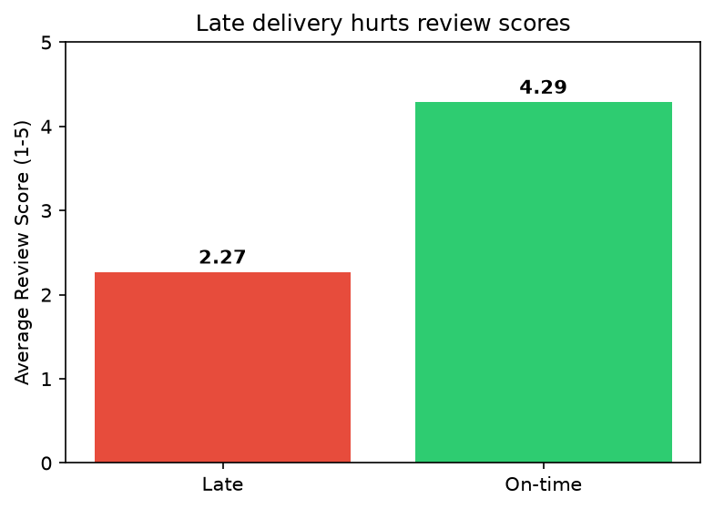
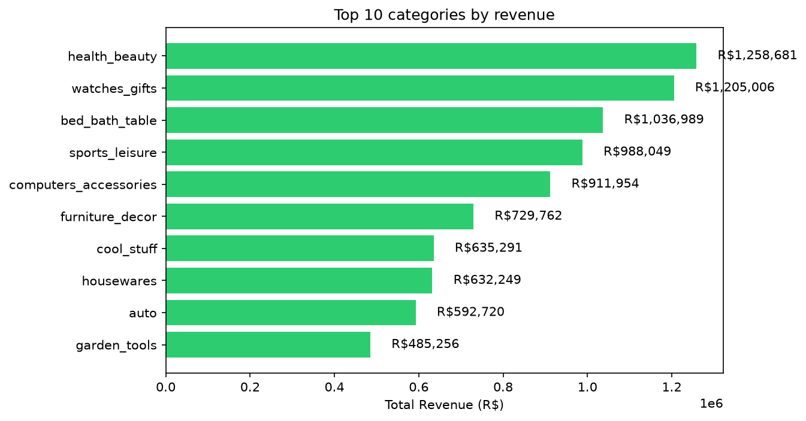
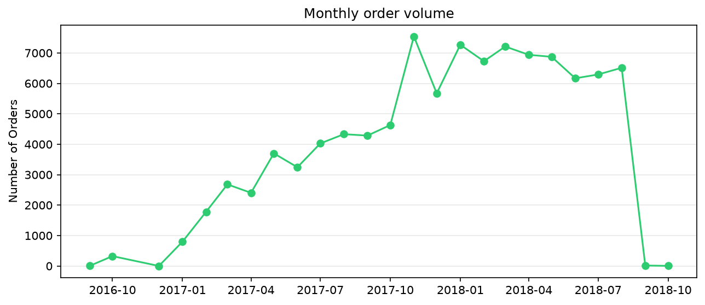

Juel Antonio Teixeira Baptista
Ocotober 15, 2026

# Olist Brazilian E-Commerce — SQL Analysis

End-to-end SQL analysis of ~100K orders from Olist, a Brazilian e-commerce marketplace (2016–2018).

## Question

What drives customer satisfaction and revenue?

## Data

9 relational tables — orders, order items, payments, customers, reviews, products, sellers, geolocation, and category translations.

Source: https://www.kaggle.com/datasets/olistbr/brazilian-ecommerce

## Approach

1. **Load** — All 9 CSVs into a PostgreSQL `raw` schema (all columns as `text`)
2. **Clean** — Built a `clean` schema: cast timestamps and numerics, converted empty strings to NULL
3. **Audit** — Verified row counts, key uniqueness, and missing values
4. **Analyze** — Answered 5 business questions using joins, CTEs, and window functions
5. **Visualize** — Charted the key findings with matplotlib

## Key findings

1. **Credit card dominates** — the most common payment method, and carries the highest average order value.
2. **Three categories drive the most revenue** — health_beauty, watches_gifts, and bed_bath_table.
3. **Late delivery hurts reviews** — late orders average **2.5★** vs **4.3★** on-time.
4. **Order volume grew fast** — steady through 2016, sharp growth through 2017, peaking in 2018.
5. **Repeat customers spend more per person** (~260) but one-time customers contribute more to total revenue.

## Charts

**Late deliveries average 1.8 fewer stars**


**Health & Beauty is the top revenue category**


**Order volume grew rapidly through 2017 and 2018**


## Data quality notes

- **2,965 orders (2.98%)** have no delivery date — these are undelivered or cancelled orders, excluded from delivery-time analysis.
- **160 orders (0.16%)** have no approval date.
- **57,742 reviews (58.67%)** have no written comment — review *scores* are the reliable signal for sentiment.

## Skills

PostgreSQL · data cleaning · joins · CTEs · window functions ·
aggregation · data quality · data storytelling · matplotlib

## Structure

- `sql/01_create_schema.sql`
- `sql/02_load.sql`
- `sql/03_clean.sql`
- `sql/03b_data_quality.sql`
- `sql/04_analysis.sql`
- `make_charts.py` — A Python script that connects to the database and generates the charts below.
- `charts/` — Output images generated by the script and used in this README.

## Reproducing

1. Download the 9 CSVs from Kaggle (link above) and unzip them into a `data/` folder.
2. Run the SQL files in order using `psql`: 
   `01_create_schema.sql` → `02_load.sql` → `03_clean.sql` → `03b_data_quality.sql` → `04_analysis.sql`
3. Set up the Python environment and generate the charts:
   ```bash
   python3 -m venv venv
   source venv/bin/activate  # On Windows: venv\Scripts\activate
   pip install pandas sqlalchemy psycopg2-binary matplotlib
   python make_charts.py
